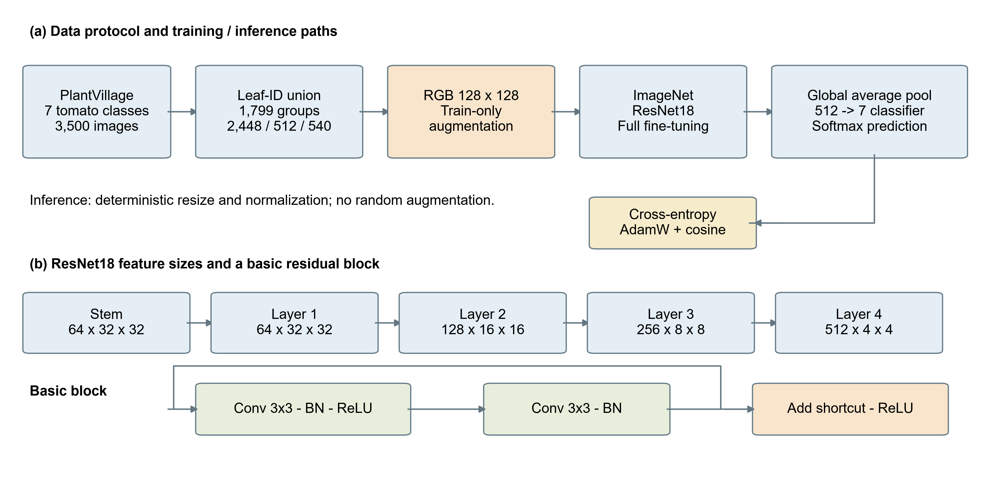
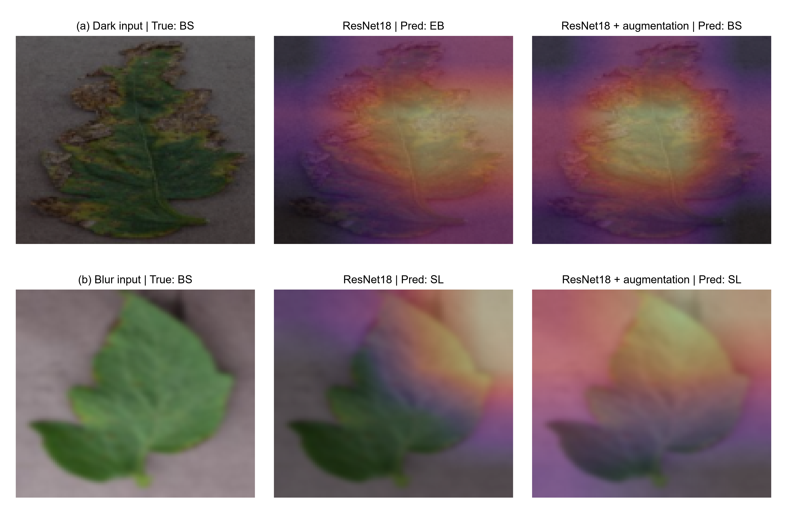

# 基于卷积神经网络的农作物叶片病害识别

以PlantVillage七类番茄叶片为对象的课程实验：小型CNN、ImageNet预训练ResNet18及同结构的数据增强版本。三种配置各训练10轮、重复三个随机种子。本项目不是新网络，也不是经田间验证的诊断系统。

## 论文与模型下载

| 材料 | 下载入口 | 说明 |
|---|---|---|
| 全面终审论文 Word | [paper_final_v1.3.1.docx](https://github.com/a1524365962-cyber/tomato-leaf-disease-course/releases/download/v1.3.1.0/paper_final_v1.3.1.docx) | 中文摘要、6图5表、4个原生公式，中文个人信息留空；英文题目保留 |
| 论文 PDF | [paper_final_v1.3.1.pdf](https://github.com/a1524365962-cyber/tomato-leaf-disease-course/releases/download/v1.3.1.0/paper_final_v1.3.1.pdf) | 与Word同版导出 |
| 源码与结果 | [source_and_results_v1.3.1.zip](https://github.com/a1524365962-cyber/tomato-leaf-disease-course/releases/download/v1.3.1.0/source_and_results_v1.3.1.zip) | 不含原始数据及权重 |
| 全部九个权重 | [trained_checkpoints.tar.gz](https://github.com/a1524365962-cyber/tomato-leaf-disease-course/releases/download/v1.0.0/trained_checkpoints.tar.gz) | 三个配置各三个种子，后续版本未改动 |
| 下载校验及修订说明 | [v1.3.1.0 Release](https://github.com/a1524365962-cyber/tomato-leaf-disease-course/releases/tag/v1.3.1.0) | 论文、检查清单及SHA256 |

权重归档共250,243,695字节，SHA256：

    92285ee5a12593adb4eb6b98fa38fec6dead5164411951bf3ada73891f3fbe46

在仓库根目录解压 `tar -xzf trained_checkpoints.tar.gz`，恢复九个 `runs/<method>_seed<seed>/best.pt`。不要加载不可信PyTorch检查点。不需要创建额外分支来找模型；正式内容在main，历史版本用Release和tag保留。

## 真实实验结果

以下为三个训练种子的均值±样本标准差，百分比单位；共享固定划分。

| 配置 | 原图准确率 | 原图宏F1 | 模糊宏F1 | 暗化宏F1 | 参数量 |
|---|---:|---:|---:|---:|---:|
| 小型CNN | 92.35±0.47 | 92.26±0.53 | 36.26±0.97 | 28.14±2.25 | 94,375 |
| ResNet18 | 96.91±0.57 | 96.89±0.53 | 67.23±4.13 | 81.45±1.89 | 11,180,103 |
| ResNet18+增强 | 97.65±1.30 | 97.59±1.35 | 67.64±2.52 | 95.83±1.51 | 11,180,103 |

增强相对同结构基线的配对宏F1变化：原图+0.70±1.65个百分点、暗化+14.38±2.84个百分点、模糊+0.41±5.83个百分点。只有暗化条件下三个种子的方向均为正；不作统计显著性或田间泛化声明。CNN还改变了初始化、模型规模与学习率，不能隔离单一因素。

张量层叠是结构示意，不是实测激活；Grad-CAM以真实类别为事后解释目标，不是病斑分割或部署输入。[配图参考索引](FIGURE_REFERENCES.md)与[证据约定](FIGURE_CONTRACT.md)区分借鉴形式和实际方法。

## 快速核验 不需要数据或显卡

Python3.10及以上，只依赖标准库：

    git clone https://github.com/a1524365962-cyber/tomato-leaf-disease-course.git
    cd tomato-leaf-disease-course
    python verify_artifacts.py
    python -m unittest test_verify_artifacts test_training_protocol test_prepare_frozen -v
    python verify_artifacts.py --checkpoint-archive trained_checkpoints.tar.gz

最后一条仅在已下载归档时运行。核验覆盖3500行清单、跨集合路径/哈希/原子ID隔离、九个配置及最佳验证轮次、27份各540条预测的路径唯一性与标签、混淆矩阵/逐类指标、均值/样本SD、配对差值和源数据表。它不会重新推理，也不验证缺失原图。

## 运行环境

原实验为Ubuntu、Python3.10.13、PyTorch2.3.0+cu118、torchvision0.18.0+cu118、NumPy1.26.0、Pillow9.4.0，一张RTX4090、FP32。建议独立环境：

    python3.10 -m venv .venv
    source .venv/bin/activate
    python -m pip install torch==2.3.0 torchvision==0.18.0 --index-url https://download.pytorch.org/whl/cu118
    python -m pip install -r requirements.txt

CUDA驱动须兼容cu118，不保证此命令适合所有驱动。训练、权重复核及CAM需要GPU；单图预测默认CPU。不同后端、硬件或Pillow版本可能改变边界样本数值，不承诺跨环境逐位一致；复现预处理时保留Pillow9.4.0。

## 数据与冻结划分

来源：[PlantVillage作者仓库固定版本](https://github.com/spMohanty/PlantVillage-Dataset/tree/7f7ecc7e1eaca78107e3affe7cb5abd9427e139a)。以文件标识匹配leaf-map.json，排除本文规则无法核对身份的靶斑病和花叶病毒病，并将红蜘蛛损伤排除在病害任务之外。七个保留类别各抽样500张。

任一原子叶片ID共享或像素相同的图像先合并，再按类以组为单位划分。3500张形成1799个连通组，训练2448、验证512、测试540；分组比例约70/15/15，不等于严格图像数比例，也不能保证已排除所有视觉近重复。

标准克隆已有manifest.json，运行：

manifest.json通过.gitattributes固定LF行尾，因为正式配置绑定其字节SHA256；不要用编辑器重新排版或转换其行尾。

    python prepare_experiment.py

从固定commit恢复3500张指定图像，校验文件与RGB像素SHA256；已有清单不会重写或重新抽样，已有缓存不符即报错，不自动覆盖。需要网络。完整原图集不随仓库分发。

完整审计还需元数据，以下clone不检出原始图像：

    git clone --filter=blob:none --no-checkout --depth 1 https://github.com/spMohanty/PlantVillage-Dataset.git source_metadata
    git -C source_metadata fetch --depth 1 origin 7f7ecc7e1eaca78107e3affe7cb5abd9427e139a
    git -C source_metadata update-ref HEAD 7f7ecc7e1eaca78107e3affe7cb5abd9427e139a
    python audit_experiment.py

仅当独立新实验目录没有manifest.json时，prepare才会根据固定元数据生成新清单。不要删除提交用清单来替代恢复操作。

## 训练与模型选择

    CUDA_VISIBLE_DEVICES=0 python train_experiment.py

GPU编号需根据实际获准设备设置，单卡通常为0。三种配置×三个种子，每次10轮、批量64、输入128，AdamW、权重衰减0.0001和余弦调度；CNN学习率0.001，ResNet18为0.0003。ResNet18全层微调torchvision IMAGENET1K_V1参数。

增强只作用于训练；验证/测试确定性缩放及归一化。每轮按最大验证宏F1选权重，并列取最早轮次，不按测试挑种子。模糊为缩放后高斯半径1.5，暗化亮度因子0.6，均不是外部场景数据。

已完成且协议一致的run会跳过。若要从头训练，在另一份实验副本中恢复数据后，将该副本runs目录重命名留存，再训练；不要覆盖提交用记录。

## 权重复核与预测

恢复数据及可信权重后：

    CUDA_VISIBLE_DEVICES=0 python verify_checkpoint.py
    python predict.py --checkpoint runs/resnet18_aug_seed2026/best.pt --image /path/to/leaf.jpg

前者在原CUDA设置下核对九个模型的540张原图预测，已有记录见checkpoint_reload_audit.json。后者CPU输出闭集top3；softmax不是校准诊断置信度，不应据此输出用药方案。原环境验证不等于所有新环境下均逐项相同。

## 重绘与生成论文

    python -m pip install -r requirements-paper.txt
    python analyze_results.py
    python select_visuals.py
    CUDA_VISIBLE_DEVICES=0 python extract_cams.py
    python illustrate_paper.py
    python build_paper.py

select_visuals、extract_cams及illustrate需要原图，CAM还需权重/GPU；只生成现有图表对应的Word可直接运行build_paper，无需原图/GPU。Windows可用render_word.ps1导出，其他平台使用Word兼容渲染器。

figures目录已有PNG/SVG/PDF，结构图另有600dpi TIFF；render_model_overview可单独重绘（需所选原图）。可选外部审计器仅在FIGURE_QA_SCRIPTS配置后启用，缺失时明确报告不可用。

## 文件导航

| 文件或目录 | 内容 |
|---|---|
| manifest.json / data_summary.json | 原图路径、双哈希、叶片ID、固定划分与数量 |
| runs/<method>_seed<seed>/ | 配置、10轮历史、三个条件的逐图预测与指标 |
| results_summary.json / metrics_source.csv | 种子汇总、配对差值、量化图源数值 |
| environment.json | 原实验软硬件 |
| audit.json / checkpoint_reload_audit.json | 完整数据/指标及CUDA权重复核记录 |
| verify_artifacts.py / test_*.py | 轻量核验及损坏记录回归测试 |
| build_paper.py / word_math.py / paper_text.md | 论文生成、原生公式及可检索正文 |
| visual_examples.json / cams_metadata.json | 示例选择路径与解释元数据 |
| FINAL_REVIEW.md | 全面检查、修订清单与审核边界 |

## 来源 许可与工具说明

原创代码按[MIT](LICENSE)提供，不重授权第三方数据、预训练权重或派生模型。[作者数据卡](https://huggingface.co/datasets/mohanty/PlantVillage)标注CC BY-SA3.0，样本和派生解释拼图依同样署名及共享要求使用。仓库不含全量原图，但包含少量派生样本图，不能称为自行采集。

未使用PlantDoc/PlantWild原始数据或多模态模型。AI辅助用于代码、实验组织、资料核对、分析和文稿初稿；实验实际执行，指标可从逐图预测重算。学生仍须阅读理解并遵守课程AI使用要求。本作业不替代农业专家诊断。
